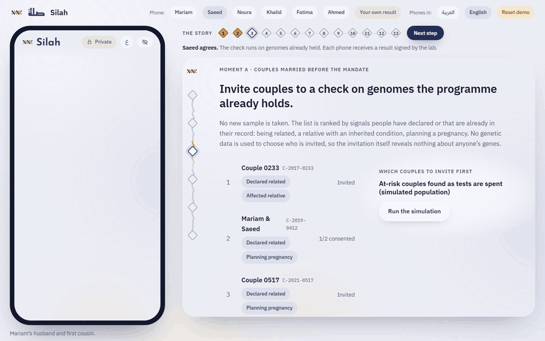
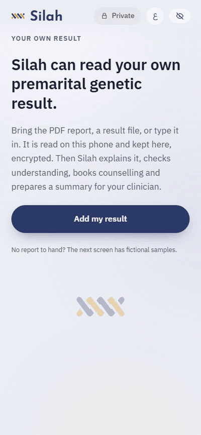
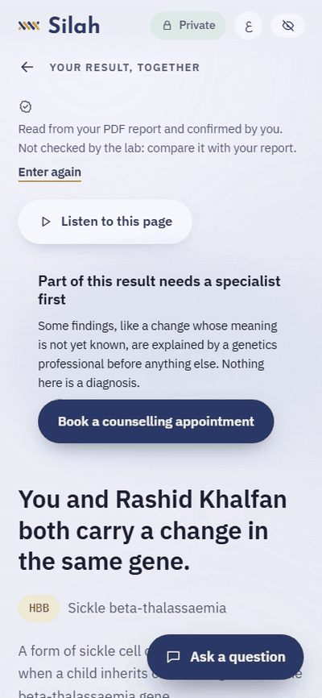
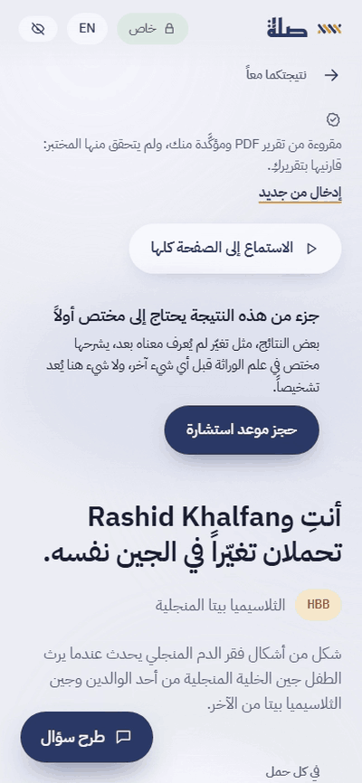

# Silah · صلة

**A private companion for inherited disease risk in Abu Dhabi, from the couple check to counselling, birth and family.**

[](https://github.com/Marc-Dvci/Silah/actions/workflows/ci.yml)
[](#evidence)
[](#evidence)
[](https://github.com/Marc-Dvci/Silah/actions/workflows/codeql.yml)
[](https://github.com/Marc-Dvci/Silah/actions/workflows/live.yml)
[](LICENSE)
[](https://marc-dvci.github.io/Silah/demo/)

<a href="https://youtu.be/WRUiVqy99SY"></a>

**[Watch the film, 2:48](https://youtu.be/WRUiVqy99SY)** · [Live demo](https://marc-dvci.github.io/Silah/demo/) · [Product page](https://marc-dvci.github.io/Silah/) ([العربية](https://marc-dvci.github.io/Silah/ar.html)) · [Deck (PDF)](https://marc-dvci.github.io/Silah/assets/silah-deck.pdf) · [Assumptions and limitations](docs/ASSUMPTIONS_AND_LIMITATIONS.md) · [Responsible AI, clause by clause](docs/RESPONSIBLE_AI.md)

I lead AI for the internal audit function of a European banking group, where I audit information systems against the GDPR and the EU AI Act, and I build offline clinical AI. Silah is an independent entry.

| Live demo | Track | Built with | Headline measurements |
|---|---|---|---|
| [Open it, no login](https://marc-dvci.github.io/Silah/demo/) | Future Health Digital Innovation Challenge · Fertility · Challenge 03, *Understanding and Reducing Inherited Disease Risk* | Gemma 4, Preact, Transformers.js, pdf.js, HL7 FHIR, Cloudflare Workers | 169 of 169 model sentences passed the verifier; 73 of 73 wrong-chance mutants blocked; 0 WCAG 2.2 AA violations on 39 screens |

[For judges](#for-judges) · [See it work](#see-it-work) · [The problem](#the-problem) · [How it works](#how-it-works) · [Evidence](#evidence) · [Run it](#run-it) · [Documents](#documents)

> [!TIP]
> Nothing to install: open the [live demo](https://marc-dvci.github.io/Silah/demo/) on a desktop, press **Start the story**, then **Next step**. To bring a report, press the green **Your own result** chip; fictional sample reports are one tap away. To run it yourself: [Run it](#run-it).

## For judges

| Criterion | Where it is answered |
|---|---|
| Health impact and clinical relevance | [The problem](#the-problem) · [Three moments](#three-moments) · [how the numbers move with detection](docs/SENSITIVITY.md) · [readability against the DoH sheet](docs/READABILITY.md) · [every source and the statement it supports](docs/SOURCES.md) |
| Technical depth and architecture | [How it works](#how-it-works) · kernel: [`bothNegative`](https://github.com/Marc-Dvci/Silah/blob/v1.0.0/src/core/kernel.ts#L81-L85), [`atLeastOne`](https://github.com/Marc-Dvci/Silah/blob/v1.0.0/src/core/kernel.ts#L88-L90), [`coupleView`](https://github.com/Marc-Dvci/Silah/blob/v1.0.0/src/core/kernel.ts#L144-L314) · verifier: [`verifySentence`](https://github.com/Marc-Dvci/Silah/blob/v1.0.0/src/core/verifier.ts#L332-L355), [`bindClaims`](https://github.com/Marc-Dvci/Silah/blob/v1.0.0/src/core/verifier.ts#L267-L274) · cryptography: [`requestInvites`](https://github.com/Marc-Dvci/Silah/blob/v1.0.0/src/core/crypto/invites.ts#L27-L37), [`seal`](https://github.com/Marc-Dvci/Silah/blob/v1.0.0/src/core/crypto/pairing.ts#L39-L43) · [threat model](docs/THREAT_MODEL.md) |
| Working solution and demonstration quality | [Live demo](https://marc-dvci.github.io/Silah/demo/) · [film](https://youtu.be/WRUiVqy99SY) · [See it work](#see-it-work) · [Evidence](#evidence) · the whole story through the real interface: [`tests/e2e/flow.py`](https://github.com/Marc-Dvci/Silah/blob/v1.0.0/tests/e2e/flow.py), [`tests/e2e/own.py`](https://github.com/Marc-Dvci/Silah/blob/v1.0.0/tests/e2e/own.py) |
| Responsible AI, safety and data governance | [DoH Responsible AI Standard, clause by clause](docs/RESPONSIBLE_AI.md) · [What it will not do](#what-it-will-not-do) · hard routes: [`route`](https://github.com/Marc-Dvci/Silah/blob/v1.0.0/src/core/routes.ts#L79-L85) · [data and rights](docs/DATA_AND_RIGHTS.md) · [assumptions and limitations](docs/ASSUMPTIONS_AND_LIMITATIONS.md) |
| Scalability and deployment readiness | [Integration with DoH, M42 and SEHA](docs/INTEGRATION.md) · [result format](schema/result-bundle.schema.json) · [FHIR export](https://github.com/Marc-Dvci/Silah/blob/v1.0.0/src/core/fhir.ts#L535-L701) · [offline on Android 13](docs/evidence/android13_live_site_airplane_mode.png) · [outreach simulator](docs/EVALUATION.md) |
| Commercial viability and path to pilot | [Path to pilot, with measured, assumed and priced figures](docs/PILOT.md) · [deck](https://marc-dvci.github.io/Silah/assets/silah-deck.pdf) |

## See it work

Each step of the guided story moves the phone and the health-system side together:



| Bring your own report | In plain words, each sentence checked | The same result in Arabic |
|---|---|---|
|  |  |  |

The demo runs in the browser with a fictional family: on a desktop it shows a phone and the health-system side together, with a thirteen-step guided story. **Use your own result** (the green chip on the stage, or `#/p/me`) reads a premarital genetic report you bring, as a PDF, an HL7 FHIR file or typed in, on the device; fictional sample reports are one tap away.

## The problem

Abu Dhabi's premarital genetic test reaches couples marrying now: 11,748 couples from 2022 to July 2026, 565 of them incompatible.[^1] It does not reach the couples already married. Abu Dhabi recorded 15,628 Emirati births in 2024,[^2] and on stated inputs at least three in four of this year's Emirati births are to couples the test never reached ([the estimate, worked out](docs/PILOT.md)). More than 900,000 Emiratis are already sequenced.[^3] The people who explain a result are few: nine genetic counsellors and eight clinical geneticists for nearly 11 million people.[^4]

A "compatible" result also reads as zero. In the demo, a cousin couple's certificate says "No risk", where Silah's model gives about 1 in 160 per pregnancy for the panel.

Silah is for a person like Mariam in the demo: married to her cousin Saeed since 2019, one daughter, hoping for a second child, and never offered a genetic couple check.

### Three moments

Silah serves three moments where knowing a genetic risk can still change an outcome:

1. **Before the next pregnancy.** Couples who married before genetic testing joined premarital screening are invited, by non-genetic signals only, to a couple check run on genomes the Emirati Genome Programme already holds. Both partners must consent.
2. **At birth.** For conditions where days matter (SMA, Krabbe, MLD, Pompe, MPS I), an at-risk couple can choose a birth plan: the delivery hospital tests the baby in the first days. It is offered only where the condition has an early-treatment pathway. This works whatever the couple decided before, so it serves the couples who marry and conceive naturally. It complements DoH's newborn genome screening, which reports within 21 days where it is offered: when the parents' shared change is already known, a targeted test of that one change can answer in the first days, at any delivery hospital.
3. **In the family.** A carrier can invite relatives to test with blind-signed invitations. The clinic can verify each invitation but cannot tell who sent it.

Between those moments, Silah explains the result in Arabic or English, including what is still uncertain, checks understanding, answers questions, never steers a decision, and hands the couple to a genetic counsellor who already has a brief.

### Bring your own result, and act on it

| What a person can do | What Silah does | Where |
|---|---|---|
| Bring a real report | **Use your own result**: a PDF report (read on the phone with pdf.js: gene on the DoH panel, HGVS change, classification, couple section, detection), an HL7 FHIR genomics file, a Silah result file, or typed entry. The person confirms every line before anything is computed; the file never leaves the device; the result is labelled "entered by you" everywhere, and only a lab-signed file counts as verified. Three fictional sample reports to try | `src/core/import/`, `src/core/fhir.ts`, `src/ui/person/import.tsx`, `public/samples/` |
| Read it in plain words, with what is uncertain | **Explain in plain words**: Gemma 4 writes the explanation of the person's own result and of what is uncertain (detection, the range it gives, assumed frequencies, the reading of the report), and a paragraph for the clinician. Every sentence is shown only if the verifier passes it on the phone; the fixed text it was checked against is one tap away. 169 of 169 Gemma 4 E4B sentences passed on 27 explanations ([`eval/EXPLAIN.md`](eval/EXPLAIN.md)). The model runs on the device, on the computer, or (opt-in, names removed) on Silah's explanation service | `src/llm/explain.ts`, `src/core/uncertainty.ts`, `src/ui/person/explain.tsx` |
| Share with a partner, live | Partners pair their phones by QR code or link; each shares chosen findings, live, end-to-end encrypted through a small relay that stores ciphertext only; either can stop at any time | `src/core/crypto/pairing.ts`, `src/ui/person/partner.tsx`, `relay/` |
| Give the doctor one page | One page from the phone: result and source, couple result and chances, uncertainties, understanding check, questions, sharing, appointment, and an optional checked AI paragraph. Prints to A4, exports as an HL7 FHIR document, or goes to the clinic with a revocable receipt | `src/app/summary.ts`, `src/ui/summary.tsx`, `exportSummaryFhir` |
| Book counselling directly | The person picks the place (the Appendix 13 sites, suggested in the order the standard gives for their result), format, language, the counsellor's sex and the time; urgent cases see held slots; the clinic confirms, the phone adds it to the calendar, and the time can be sent to the partner's phone | `src/core/booking.ts`, `src/ui/person/book.tsx`, clinic Appointments |

## How it works


Plain code computes every number and decides what is shown. Gemma 4 only phrases, and a sentence reaches the screen only if the verifier passes it. The figure's source is [`docs/figures/architecture.html`](docs/figures/architecture.html).

| Part | Where | What it guarantees | Test |
|---|---|---|---|
| Risk kernel | `src/core/kernel.ts`, `fraction.ts` | Every number is an exact fraction with its arithmetic and sources; tested against a hand-calculated grid. For related partners it counts a change inherited from a shared ancestor; across genes it gives the chance of at least one condition; it uses the detection the lab states in the signed result, and gives ranges when the result does not state it | `tests/kernel.test.ts` |
| Gene panel | `src/core/data/panel.ts` | The 563 genes of the DoH premarital panel (Standard V3, Appendix 12: 570 printed names, 5 repeated and 2 older names of listed genes), mapped to current HGNC symbols | `tests/panel.test.ts` |
| Answers and explanations | `src/llm/answer.ts`, `src/llm/explain.ts`, `src/core/verifier.ts` | The model writes; the phone shows a sentence only if the verifier passes it, with the cited cards one tap away. If none passes, the person reads the cited cards in their own words, and an option is never shown alone. The verifier scores the model's own wording in the evaluation: a sentence passes only if it cites a fact card, uses only that card's numbers, gives each chance the value the card states for that outcome and that person, does not steer, and states no certainty about a child | `tests/verifier.test.ts`, `tests/binding.test.ts`, `tests/quote.test.ts`, `eval/binding.mjs` |
| Hard routes | `src/core/routes.ts` | Distress, termination, religious rulings, other people's results and blame go to a person, before any model. The phone says a request was received, or seen by a counsellor, only when the clinic confirms it | `tests/verifier.test.ts` (hard routes), `tests/quote.test.ts`, `tests/e2e/flow.py` |
| Own report | `src/core/import/`, `src/core/fhir.ts` | A report is read on the phone and confirmed line by line; a result entered by the person stays labelled as entered | `tests/extract.test.ts`, `tests/fhir.test.ts`, `tests/ownresult.test.ts`, `tests/e2e/own.py` |
| Receipts | `src/core/crypto/receipts.ts` | Every consent and share is signed on the device, hash-chained, and revocable | `tests/receipts.test.ts`, `tests/sign.test.ts` |
| Invitations | `src/core/crypto/invites.ts` | RSA blind signatures (RFC 9474): issuance and redemption logs cannot be linked | `tests/invites.test.ts` |
| Linked phones | `src/core/crypto/pairing.ts`, `relay/` | The key stays in the link fragment; the relay holds ciphertext only | `tests/pairing.test.ts`, `tests/e2e/own.py` |
| Booking | `src/core/booking.ts` | The Appendix 13 sites in the order the standard gives for the result, with held slots for urgent cases | `tests/booking.test.ts` |
| Sources | `src/core/data/sources.ts` | A source a person can tap has been checked for the statement it supports | `tests/sources.test.ts` |
| Population simulator | `src/core/population.ts` | Compares outreach strategies on a synthetic consanguineous population | `tests/population.test.ts` |

Privacy rule, enforced in code and checked end to end (`tests/e2e/flow.py`): **each partner learns only the genes they both carry**. A partner's other findings stay on that partner's phone unless they choose to share them. The clinic sees only the shared genes and what the couple chose to send.

### Where the language model runs

| Where | Model | Through | Why there |
|---|---|---|---|
| In the browser on the phone | Gemma 4 E2B | Transformers.js on WebGPU, about 3 GB downloaded once, on request | Nothing leaves the device |
| On the same computer | Gemma 4 E4B | llama.cpp | 22 of 22 grounded questions and 169 of 169 explanation sentences; Qwen3.5-4B, on the same sets, 22 of 22 and 171 of 177 ([`eval/REPORT.md`](eval/REPORT.md), [`eval/EXPLAIN.md`](eval/EXPLAIN.md)) |
| On Silah's explanation service, if the person chooses it | Gemma 4 26B | Cloudflare Workers AI | For a phone that cannot run a model; names are removed first, nothing is stored, and the phone's verifier checks the text |

## What it will not do

- It never tells a family what to decide: a sentence that steers is blocked ([`isDirective`](https://github.com/Marc-Dvci/Silah/blob/v1.0.0/src/core/verifier.ts#L308-L319)).
- It never states an outcome for a particular child ([`isCertainty`](https://github.com/Marc-Dvci/Silah/blob/v1.0.0/src/core/verifier.ts#L327-L330)).
- It answers distress, termination, religious rulings, blame and questions about other people's results with a person, before any model ([`route`](https://github.com/Marc-Dvci/Silah/blob/v1.0.0/src/core/routes.ts#L79-L85)).
- It invites couples on declared signals only, never on genetics.
- It shows a partner only the genes both carry, unless a person chooses to share more.
- It says a counsellor has seen a request only once the clinic confirms it.
- It counts only a lab-signed result as verified; a report a person brings stays labelled as entered by them.

## Evidence

| What | Result | Command |
|---|---|---|
| Unit tests, in random order | 307 passed, 0 skipped | `npm test` |
| Decision core coverage (`src/core`), with a floor of 90% lines and 80% branches in CI | **96.9% lines, 83.9% branches, 94.5% functions** | `npm run coverage` |
| The whole demo story through the real interface | 31 checks | `python tests/e2e/flow.py` |
| Own report, from upload to linked phones, with the live relay | 30 checks | `python tests/e2e/own.py http://127.0.0.1:5173/ https://silah-relay.pages.dev` |
| All thirteen steps of the guided story, by pressing Next only | 28 checks | `python tests/e2e/stage.py` |
| WCAG 2.2 AA with axe-core, Arabic and English | 0 violations on 39 screens | `python tests/e2e/a11y.py` |
| Product page in both languages, as GitHub Pages serves it | 20 checks | `python tests/e2e/site.py` (after `npm run build`) |
| The built app with the network off | A result opens and a PDF is read | `python tests/e2e/offline.py` (with `npx vite preview --port 4173`) |
| Gemma 4 E2B inside the browser | Answers through the verifier on WebGPU | `python tests/e2e/webgpu.py` |
| Plain-language explanations through the verifier | Gemma 4 E4B 169 of 169 sentences, Gemma 4 26B 153 of 153, on 27 explanations | [`eval/EXPLAIN.md`](eval/EXPLAIN.md), `node eval/explain.mjs <label> "<model>"` (llama-server on :8080) |
| Claim-binding mutation test on saved model answers | 73 of 73 wrong-chance mutants blocked; 0 originals blocked | [`eval/BINDING.md`](eval/BINDING.md), `node eval/binding.mjs` |
| Model bake-off, 52 questions in two languages | Gemma 4 E4B: 22 of 22 grounded questions answered; on the phone, 30 of 30 traps met with the fixed cards | [`eval/REPORT.md`](eval/REPORT.md) |
| Readability against the DoH information sheet | English grade 6.4 against 14.2; Arabic OSMAN 83.4 against 67.4 | [`docs/READABILITY.md`](docs/READABILITY.md), `python eval/readability/score.py` |
| How the numbers move with detection and the assumed frequency | Fatima's whole-panel figure: 1 in 82 at 80% detection to 1 in 1,000 at 99% | [`docs/SENSITIVITY.md`](docs/SENSITIVITY.md), `node eval/sensitivity.mjs` |

The end-to-end scripts drive the real interface headless with Playwright. CI runs the unit tests, coverage, types, the build, the product-page checks, spelling and local links on every push, and a [scheduled job](.github/workflows/live.yml) plays the whole story on the live site.

## What is real and what is simulated

> [!IMPORTANT]
> The app, the risk kernel, the verifier, the cryptography, the model runs, the relay and the explanation service are real and running. The family, their genomes and all clinic data are fictional, and the health-system side is simulated in the browser.

- The family, their genomes and all clinic data are fictional. No real person's data is used.
- The health-system side is simulated in the browser. In a deployment it would be DoH, M42 and SEHA services; the messages are already self-contained and signed.
- Arabic text is Modern Standard Arabic written for this prototype, using the DoH booklet's wording where possible, with masculine and feminine forms for the reader.
- Every chance is model-derived: exact arithmetic on stated inputs. Carrier frequencies are published Emirati figures for seven genes; the rest use 1 in 1,000, the most cautious value consistent with the published added chance for first cousins. Detection rates come from the lab in the signed result; the demo's simulated lab states example values (90% per gene, 99% for a check of the exact family change), and a result without them gets ranges. Family history is not in the numbers, and every result says so.
- The full list is in [`docs/ASSUMPTIONS_AND_LIMITATIONS.md`](docs/ASSUMPTIONS_AND_LIMITATIONS.md).

## Run it

Needs Node 24. Nothing else, and no API key: everything except pairing runs on one machine at no cost. The optional language model runs on the same computer (llama.cpp), inside the browser (WebGPU), or, if the person chooses it, on the explanation service. Pairing uses the relay in `relay/` (a Cloudflare Worker on the free plan; its address is set in `src/app/relay-url.json`).

```bash
npm ci
npm run dev          # http://127.0.0.1:5173  (desktop: phone + clinic side by side)
npm test             # unit tests: kernel, verifier, routes, crypto, population, panel
npm run coverage     # the same in random order, with coverage of src/core
npm run build        # static PWA in dist/, works offline after the first visit
```

The end-to-end checks need Python 3.10 or newer, and `npm run dev` running in another terminal unless noted:

```bash
python -m venv .venv
source .venv/bin/activate          # Windows: .venv\Scripts\activate
pip install -r requirements-dev.txt
python -m playwright install chromium

python tests/e2e/flow.py      # the whole demo story, 31 checks
python tests/e2e/own.py http://127.0.0.1:5173/ https://silah-relay.pages.dev   # own report: PDF upload, explanation, booking, summary, pairing, 30 checks
python tests/e2e/stage.py     # the guided thirteen-step story on the desktop stage
python tests/e2e/a11y.py      # axe-core WCAG 2.2 AA on 39 screens, both languages
python tests/e2e/webgpu.py    # Gemma 4 E2B inside the browser (WebGPU, ~3 GB download once)
python tests/e2e/offline.py   # the built app with the network off (needs `npx vite preview --port 4173`, not the dev server)
python tests/e2e/site.py      # the product page in both languages, as GitHub Pages serves it (after `npm run build`, no server needed)
python eval/readability/score.py   # readability of the explanations vs the DoH information sheet
node eval/binding.mjs              # claim-binding mutation test over the saved model answers -> eval/BINDING.md
node eval/sensitivity.mjs          # how the numbers move with detection and the assumed frequency -> docs/SENSITIVITY.md
node eval/explain.mjs <label> "<model>"   # plain-language explanations through the verifier -> eval/EXPLAIN.md (llama-server on :8080)
cd relay && npm ci && npx wrangler dev --port 8787   # the relay for paired phones and the explanation service, locally
```

### Layout

| Folder | What it holds |
|---|---|
| `src/core/` | The decision core: kernel, verifier, routes, import, booking, cryptography, gene panel, sources |
| `src/llm/`, `src/app/`, `src/ui/` | Model backends, app state and the screens |
| `relay/` | The Cloudflare Worker for linked phones and the explanation service |
| `site/` | The bilingual product page (`index.html`, `ar.html`) published at https://marc-dvci.github.io/Silah/, with the app under `/demo/` |
| `site/build/` | The scripts behind the page's assets: `capture_stage.py`, `capture_screens.py` and `capture_ar.py` capture screens from the app; `build_assets.py` also needs the finished film, the deck and earlier screenshots, which are not in this repository |
| `tests/`, `tests/e2e/`, `eval/` | Unit tests, real-browser checks and the model evaluation, with its saved runs |
| `schema/`, `public/samples/` | The signed result format, and fictional sample reports |

## Documents

| Document | What it answers |
|---|---|
| [Assumptions and limitations](docs/ASSUMPTIONS_AND_LIMITATIONS.md) | What the numbers assume, what the prototype depends on |
| [Responsible AI](docs/RESPONSIBLE_AI.md) | The DoH Responsible AI Standard (DoH/ST/DDGO/RAI/V1/2025), clause by clause, with the risk register |
| [Evaluation](docs/EVALUATION.md) | What was measured, how, and what it showed |
| [Threat model](docs/THREAT_MODEL.md) | What each party can and cannot learn |
| [Integration](docs/INTEGRATION.md) | How it connects to DoH, M42 and SEHA systems |
| [Path to pilot](docs/PILOT.md) | Who runs it, the protocol, and the costs: measured, assumed and priced |
| [Sensitivity](docs/SENSITIVITY.md) · [Readability](docs/READABILITY.md) | How the numbers move; how the text reads in both languages |
| [Sources](docs/SOURCES.md) · [Data and rights](docs/DATA_AND_RIGHTS.md) · [Panel extraction](docs/panel_extraction.md) | Every source and the statement it supports; rights to use; how the 563 genes were read |
| [Sample reports](docs/SAMPLE_REPORTS.md) · [Security](SECURITY.md) | The fictional reports to try; how to report a vulnerability |

## Licence

Apache License 2.0, see `LICENSE`. Third-party components keep their own licences (`docs/DATA_AND_RIGHTS.md`).

[^1]: Gulf News, updated 3 October 2026. All figures with their wording are in [`docs/SOURCES.md`](docs/SOURCES.md).
[^2]: Gulf Today, 3 August 2025, citing DoH and the Statistics Centre Abu Dhabi.
[^3]: Aletihad, feature with the Director of the Genome and Biobank Division, DoH.
[^4]: Almarri et al., J Genet Couns 2025;34(6):e70139 ([full text](https://pmc.ncbi.nlm.nih.gov/articles/PMC12619030/)).
